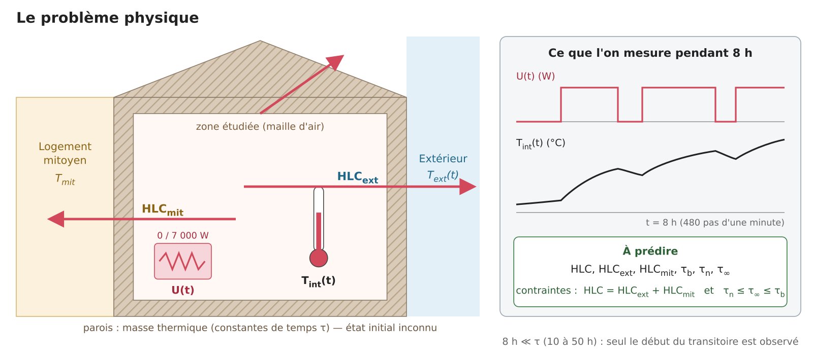
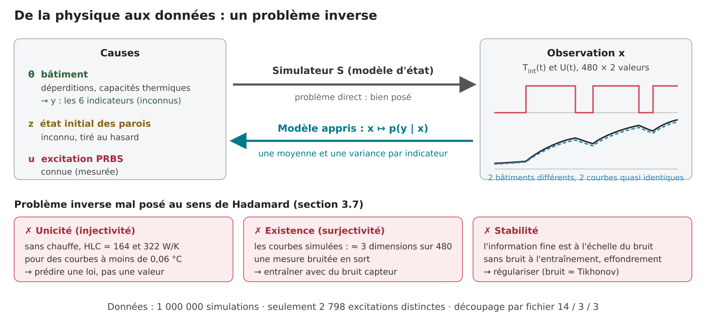
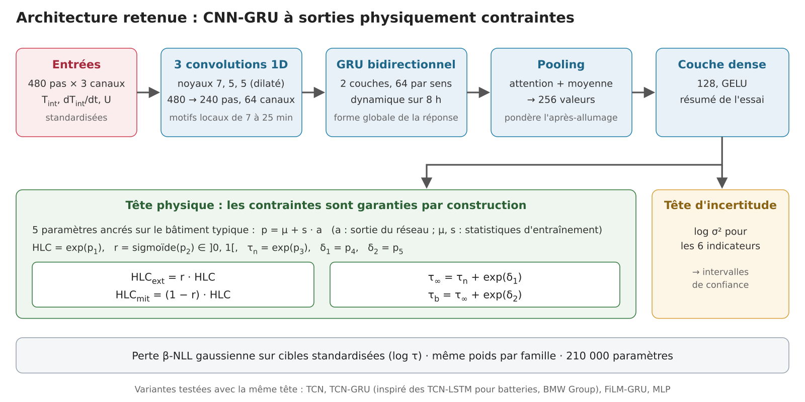

# Prédire la performance thermique d'un bâtiment à partir d'un essai de 8 h

*Assessment de stage coEnergy — Fares EL HAMDAOUI — novembre 2026*

    

À partir de 8 h de mesures à la minute de la température intérieure $T_{int}(t)$ et du chauffage $U(t)$, un réseau CNN-GRU prédit six indicateurs d'un bâtiment, `[HLC, HLC_ext, HLC_mit, tau_b, tau_n, tau_inf]`, chacun avec un intervalle de confiance calibré. Les relations physiques ($\mathrm{HLC} = \mathrm{HLC}_{ext} + \mathrm{HLC}_{mit}$, $0 < \tau_n \le \tau_\infty \le \tau_b$) sont **garanties par construction**.

> [!IMPORTANT]
> ### Lire le rapport complet
> - **En un clic, dans le navigateur** : [version HTML](https://htmlpreview.github.io/?https://github.com/Fareshd049/coenergy-assessment/blob/main/notebooks/report.html) · [version notebook (nbviewer)](https://nbviewer.org/github/Fareshd049/coenergy-assessment/blob/main/notebooks/report.ipynb)
> - **Dans le dépôt** : [`notebooks/report.html`](notebooks/report.html) (à télécharger puis ouvrir, sans installation) · [`notebooks/report.ipynb`](notebooks/report.ipynb) (exécutable)



## En bref

- **8,5 %** d'erreur relative moyenne sur le HLC en test, 95 % des erreurs sous 48 W/K.
- **Des intervalles calibrés** : l'intervalle à 95 % contient la vraie valeur dans 95,7 % des cas, et cela tient de 10 % à 99 %.
- **0 % de violation** de $\mathrm{HLC} = \mathrm{HLC}_{ext} + \mathrm{HLC}_{mit}$, contre 97,5 % pour une tête de sortie libre, sans perte de précision.
- **Robuste au bruit capteur** : $R^2$ du HLC de 0,39 sans bruit, 0,37 à 0,05 °C et 0,33 à 0,10 °C (deux fois le bruit vu à l'entraînement), avec des intervalles qui restent calibrés.
- **Validation = test** ($R^2$ de 0,391 sur les deux) : aucun surapprentissage des choix de modélisation.
- **L'excitation est le vrai levier** : en imposer une informative porte le $R^2$ du HLC de 0,39 à 0,48, et le modèle sait lui-même classer les excitations par leur informativité.

## Pourquoi un $R^2$ d'environ 0,4 est un résultat solide ici



Le problème inverse est **mal posé** : des bâtiments très différents produisent la même courbe en 8 h (ci-dessus, deux maisons à 164 et 322 W/K dont les courbes ne s'écartent jamais de plus de 0,06 °C), parce que l'état initial des parois est inconnu et que capacité et déperdition se compensent. Une partie de la variance du HLC est donc inaccessible à **tout** modèle. Quatre constats le confirment :

| Constat | Résultat |
|---|---|
| Les références font toutes moins bien | ridge 0,26 · MLP 0,30 · ROCKET 0,34 · **CNN-GRU 0,41** ($R^2$ HLC, validation) |
| Cinq architectures très différentes convergent | CNN-GRU, TCN, FiLM-GRU, TCN-GRU à 0,01 près |
| Aucun levier côté modèle ou données ne dépasse +0,02 | ×5 données +0,003 · mesures parfaites +0,02 · ensemble +0,009 · spécialistes ≈ 0 |
| Seul l'essai lui-même déplace le plafond | excitation informative : **0,39 → 0,48** sans ré-entraînement |

## Résultats par indicateur

Modèle final `final_700k_noise005`. La validation a servi aux choix ; le test (30 000 simulations) n'a été évalué qu'une seule fois, à la fin.

| Indicateur | $R^2$ validation | $R^2$ test | Erreur relative (test) | P95 erreur absolue (test) | Couverture à 95 % (test) |
|---|---|---|---|---|---|
| HLC | 0,391 | 0,391 | 8,5 % | 48 W/K | 95,7 % |
| HLC_ext | 0,319 | 0,322 | 10,3 % | 27 W/K | 96,2 % |
| HLC_mit | 0,250 | 0,256 | 15,9 % | 44 W/K | 95,7 % |
| tau_n | 0,216 | 0,217 | 12,5 % | 3,4 h | 95,6 % |
| tau_b | 0,069 | 0,075 | 15,3 % | 19 h | 95,4 % |
| tau_inf | 0,051 | 0,057 | 18,3 % | 14 h | 95,3 % |

Comme prévu par la physique : $\tau_n$, définie sur 8 h comme l'essai, est la constante de temps la mieux prédite ; $\tau_b$ et $\tau_\infty$, qui font intervenir des modes lents de plusieurs dizaines d'heures, sont à peine identifiables en 8 h.

## Le modèle



Chaque bloc répond à un constat de l'analyse exploratoire (section 5 du rapport) : les convolutions captent les réactions juste après chaque commutation, le GRU bidirectionnel la forme globale sur 8 h, l'attention les instants informatifs. La tête physique garantit les contraintes, et la tête d'incertitude prédit une variance par indicateur (vraisemblance gaussienne $\beta$-NLL). L'encodeur TCN a été transposé des modèles d'état de santé de batteries de BMW Group ([`docs/figures/analogie_batterie.png`](docs/figures/analogie_batterie.png), section 5.6).

## Installation

Le projet utilise [uv](https://docs.astral.sh/uv/) ; les versions sont figées dans `uv.lock`.

```bash
uv sync
uv run pytest            # 79 tests unitaires, sans données
uv run ruff check .      # style
```

**Données.** Placer les 20 fichiers `batch_1.pt` … `batch_20.pt` fournis par coEnergy dans `data/quentin_house/` (non versionné).

## Organisation du dépôt

```
coenergy-assessment/
├── notebooks/
│   ├── report.ipynb          rapport exécutable (en français)
│   ├── report.html           le même rapport, exécuté, lisible sans installation
│   └── kaggle_train.ipynb    lancement des entraînements sur GPU Kaggle
├── src/hlcnet/               package Python, typé et documenté (voir le tableau ci-dessous)
├── scripts/                  points d'entrée en ligne de commande (ordre d'exécution ci-dessous)
├── configs/                  une expérience = un fichier YAML, nommé comme son dossier de résultats
│   ├── cnn_gru_share_nll.yaml    modèle de référence (140 000 simulations)
│   ├── final_700k.yaml           même modèle, 700 000 simulations
│   ├── final_700k_noise005.yaml  modèle final : 700 000 simulations, bruit capteur 0,05 °C
│   ├── ablations/                une modification à la fois par rapport à la référence (section 6.1)
│   ├── perspectives/             configuration prête, non lancée (section 8)
│   └── debug.yaml                test rapide de bout en bout
├── artifacts/                résultats relus par le rapport
│   ├── runs/<expérience>/        config.yaml, model.pt, history.csv, val_metrics.json
│   ├── eda/                      homogénéité des 20 fichiers (section 3.5)
│   └── eval/                     évaluations : val/, test/, final_models/, ensemble/,
│                                 specialists/, specialists_cnn/, excitations/
├── docs/figures/             schémas du rapport (sources SVG et PNG intégrés au notebook)
├── tests/                    tests unitaires (pytest)
├── pyproject.toml, uv.lock   dépendances
└── README.md
```

### Le package `hlcnet`

| Module | Rôle | Section du rapport |
|---|---|---|
| `targets.py` | ordre canonique des 6 indicateurs, familles, unités | 2 |
| `data.py` | chargement fichier par fichier, découpage, normalisation, bruit capteur | 2, 4 |
| `eda.py` | statistiques sur le million de simulations, figures de l'EDA | 2, 3 |
| `identifiability.py` | expériences naturelles, ridge, ACP, jumelles et test Delta | 3.6, 3.7 |
| `models.py` | CNN-GRU, TCN, FiLM-GRU, MLP ; tête physique et tête d'incertitude | 5 |
| `losses.py` | $\beta$-NLL gaussienne, MSE ; pondération par famille | 5.3 |
| `train.py` | boucle d'entraînement, arrêt précoce, checkpoints | 5.4 |
| `metrics.py` | métriques par indicateur et par famille, contraintes, couverture | 4, 6, 7 |
| `analysis.py` | calibration, biais log-normal, bruit, sous-groupes, cartes d'excitation, ensembles | 6, 7 |
| `specialist.py` | spécialistes ridge et MLP par excitation | 6.6 |
| `excitation_design.py` | évaluation excitation par excitation, critère du σ prédit | 7.4 |
| `rocket.py` | référence ROCKET | 6.1 |
| `report.py` | lecture des résultats enregistrés pour le notebook | 6, 7 |
| `config.py`, `utils.py` | configuration YAML, graines, périphérique | — |
| `util_assessement.py` | chargeur fourni par coEnergy, laissé intact | — |

## Reproduire les résultats

Le notebook ne ré-entraîne rien : il relit `artifacts/`. Les scripts ci-dessous régénèrent ces résultats, dans cet ordre.

| Étape | Script | Produit | Section | Durée indicative |
|---|---|---|---|---|
| 1 | `compare_batches.py` | `artifacts/eda/` | 3.5 | 2 min, CPU |
| 2 | `train.py --config <yaml>` | `artifacts/runs/<nom>/` | 6 | 10 à 60 min par expérience, GPU |
| 3 | `rocket_baseline.py` | `artifacts/runs/rocket_ridge/` | 6.1 | 10 min, CPU |
| 4 | `evaluate.py` | `artifacts/eval/val/`, `final_models/`, `test/` | 6.4, 6.5, 7 | 5 à 15 min, CPU |
| 5 | `ensemble_eval.py`, `specialist_eval.py` | `artifacts/eval/ensemble/`, `specialists/` | 6.6 | 5 min, CPU |
| 6 | `excitation_eval.py` | `artifacts/eval/excitations/` | 7.4 b | 10 min, CPU |
| 7 | `specialist_cnn.py` | `artifacts/eval/specialists_cnn/` | 7.4 c | 1 h 30, CPU |

```bash
D=data/quentin_house
uv run python scripts/compare_batches.py --folder $D
uv run python scripts/train.py --config configs/cnn_gru_share_nll.yaml --data-folder $D
uv run python scripts/train.py --config configs/ablations/abl_tcn.yaml --data-folder $D     # idem pour chaque ablation
uv run python scripts/train.py --config configs/final_700k_noise005.yaml --data-folder $D
uv run python scripts/rocket_baseline.py --config configs/cnn_gru_share_nll.yaml --data-folder $D
uv run python scripts/evaluate.py --runs artifacts/runs/cnn_gru_share_nll artifacts/runs/abl_no_deriv artifacts/runs/abl_noise --split val --data-folder $D
uv run python scripts/evaluate.py --runs artifacts/runs/final_700k artifacts/runs/final_700k_noise005 --split val --only-noise \
    --out artifacts/eval/final_models --data-folder $D --noise-levels 0 0.02 0.05 0.1
uv run python scripts/evaluate.py --runs artifacts/runs/final_700k_noise005 --split test --no-unseen \
    --data-folder $D --noise-levels 0 0.02 0.05 0.1                                          # une seule fois
uv run python scripts/ensemble_eval.py --data-folder $D
uv run python scripts/specialist_eval.py --data-folder $D
uv run python scripts/excitation_eval.py --data-folder $D
uv run python scripts/specialist_cnn.py --data-folder $D
```

`notebooks/kaggle_train.ipynb` enchaîne les entraînements sur GPU Kaggle ; les listes d'expériences sont en tête du notebook.

## Utiliser le modèle entraîné

```python
from pathlib import Path

from hlcnet.analysis import predict_physical
from hlcnet.data import load_batches
from hlcnet.train import load_checkpoint
from hlcnet.utils import get_device

device = get_device("cpu")
model, cfg, normalizer = load_checkpoint(Path("artifacts/runs/final_700k_noise005/model.pt"), device)
data = load_batches(Path("data/quentin_house"), batch_ids=[19], per_batch=100)  # x : (100, 480, 2) = [Tint, U]
p = predict_physical(model, normalizer, data.x, device)
p.pred      # (100, 6) : HLC, HLC_ext, HLC_mit (W/K), tau_b, tau_n, tau_inf (h)
p.log_var   # (100, 6) : log-variances dans l'espace normalisé (intervalles, section 6.4)
```

## Notes

- Les checkpoints enregistrent le chemin des données utilisé à l'entraînement : passer `--data-folder` pour évaluer sur une autre machine.
- Entraînement avec torch 2.11 (Kaggle), évaluation et rapport avec la version de `uv.lock` ; les résultats ne dépendent pas de cette différence au-delà du bruit numérique.
- Graines fixées (`seed` dans chaque YAML). Sur GPU, la précision mixte et cuDNN ne garantissent pas une reproductibilité bit à bit.
